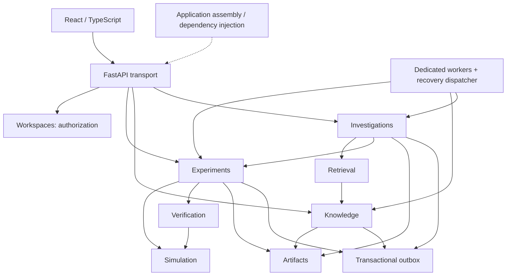

# Architecture and ownership

CommLab is a modular monolith. Workers share the same application package and database, but execute in separate processes because parsing, simulations and model calls have different resource and failure characteristics. There is no internal HTTP hop or event bus for ordinary queries.

Arrows show runtime public-API dependencies, including injected objects. Contract-only dependencies also exist: investigations uses source-reference, finding and point contracts; retrieval uses evidence contracts. The import-boundary test checks Python imports, not arbitrary dynamic attribute access. Code review is still needed to prevent illicit access through an injected session or object.

## Major entities

| Entity / rule | Owner | Persisted representation |
|---|---|---|
| Workspace identity and owner credential hash | Workspaces | workspaces |
| Membership | Workspaces | MVP: one owner credential; no multi-user membership table yet |
| Source identity, immutable source version, parsing state | Knowledge | source_versions |
| Text chunk, page/section, embedding identity and vector | Knowledge | chunks |
| Search request, evidence ranking and insufficient-evidence flag | Retrieval | typed request/result, tool history stores selected evidence |
| Experiment configuration, idempotency key, run lifecycle, lease, published results | Experiments | runs; JSON and SVG artifact references |
| Simulation primitives, capability constraints, outputs, analytic reference functions | Simulation | typed versioned formats; execution itself is stateless |
| Verification rule semantics and findings | Verification | findings snapshot stored by Experiments |
| Investigation plan, approvals, budgets, history, model usage and answers | Investigations | investigations |
| Artifact metadata, immutable blobs and content checksums | Artifacts | artifacts plus local storage |
| Durable delivery records | Job infrastructure | outbox |

Storage ownership is distinct from rule ownership: Experiments persists the findings belonging to a particular result; Verification defines how those findings are computed. No verification rule reads the runs table.

## Public boundaries

Each capability exposes its contracts and service through `commlab/<module>/api.py`. ORM classes co-located in those files are implementation details and must not be imported by other capabilities. Tests explicitly forbid cross-module ORM imports. The plotting implementation is private to Experiments.

Public operations include:

- Workspaces: create and authorize.
- Artifacts: save and workspace-scoped load.
- Knowledge: upload, ingest, sources, exact chunk lookup, filtered candidate query and recovery.
- Retrieval: search through an injected strategy and embedding provider.
- Experiments: submit, inspect, exact-field find, cancel, execute, compare and recovery.
- Simulation: typed specification/result, backend protocol and central capability registry.
- Verification: `Rule.check` and `Verifier.check`.
- Investigations: create, history, inspect, approve, advance and recovery.

`assembly.py` constructs the graph and selects providers. HTTP and worker entry points use that assembly. Modules do not import assembly. There is no service locator inside the domain modules.

## Deliberate practical exceptions

1. SQLAlchemy session factories are injected directly rather than wrapped in a repository interface per entity. Each module only reads/writes its own tables.
2. The outbox helper accepts the owning module's open transaction. This small infrastructure dependency ensures the state change and durable message commit together.
3. Artifact creation is an independent transaction. A crash or losing execution lease can leave an unreferenced artifact, but never a partially published run. Safe orphan cleanup needs a separately designed retention/read-model policy and is not automated.
4. Knowledge owns the database-specific candidate query, including PostgreSQL keyword/vector operators. Retrieval owns fusion/ranking. This preserves table ownership without pretending a storage-agnostic strategy can efficiently implement SQL ranking.
5. Worker bootstrap and migrations import module metadata. Tests may access tables for controlled fault injection. Neither exception permits business modules to query one another's tables.
6. JSON fields hold small immutable specifications/results and bounded histories. Exact searchable run fields (seed/channel) have indexed columns; they are not searched through vectors.

## Why these tools

FastAPI/Pydantic provides request validation and an exportable schema. SQLAlchemy/Alembic provides transactional state and explicit schema history. PostgreSQL/pgvector keeps filtered retrieval and business storage together. Dramatiq provides Redis delivery and bounded queue retries; application leases and idempotency handle duplicate execution semantics.

An explicit state machine is sufficient for one small investigator, so LangGraph adds no necessary capability here. Recharts serves interactive browser plots; Matplotlib serves portable server-generated figures. They have different delivery responsibilities and consume the same result contract.

Reference: [Dramatiq's idempotent actor guidance](https://dramatiq.io/best_practices.html) and [PostgreSQL row-locking guidance](https://www.postgresql.org/docs/current/sql-select.html). The design assumes at-least-once delivery, not exactly-once execution.
