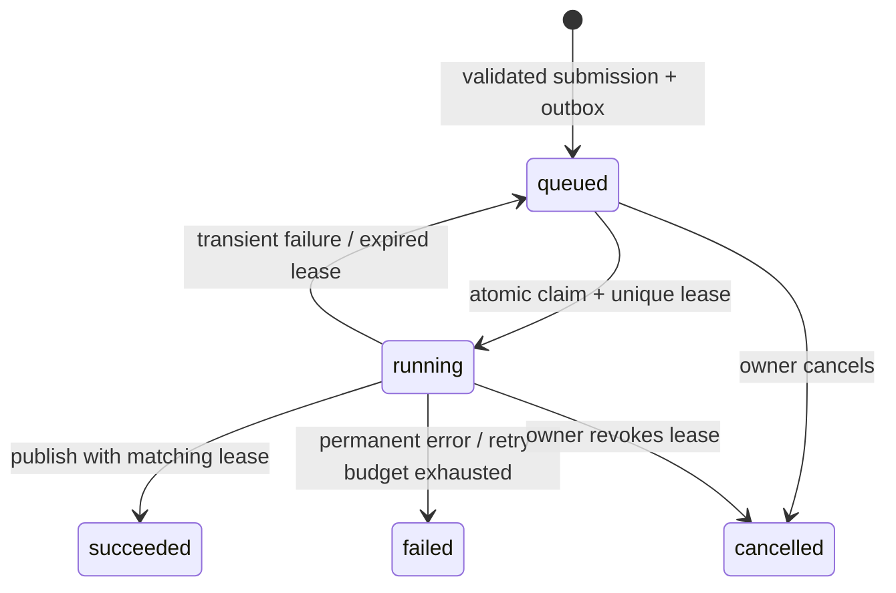

# Execution, security and operations

## Run state machine

Terminal runs do not transition back. Reproduction submits a new run. Three execution attempts are allowed for retryable storage/interruption failures. The dispatcher re-enqueues stale queued work after 60 seconds and reclaims running work after a 180-second heartbeat timeout. A stale worker cannot publish after its lease is replaced or cancelled.

Submission and its outbox row commit in one transaction. Dispatcher publication happens before marking the row delivered; a crash in that gap causes duplicate delivery. Row locking with SKIP LOCKED supports multiple PostgreSQL dispatchers. Atomic run claims, stable idempotency keys and lease-fenced publication tolerate duplicate delivery. There is no exactly-once execution claim.

The Redis workers use bounded queue retry/backoff as a transport safeguard. Application retry state is authoritative. Queue message loss before a worker claim is repaired by queued-work recovery. Cancellation is checked at batch boundaries. A small JSON artifact or plot may be orphaned if a crash/cancellation occurs before final publication. Published run results are atomic; unreferenced artifacts are retained until an explicit retention design is implemented.

The development worker reads outbox messages and acknowledges after execution. It is single-process and intentionally does not emulate Redis throughput. Use the PostgreSQL/Redis smoke test to verify the production path.

## Investigator state

`ready → running → ready` executes one bounded decision at a time. `running → review` exposes a proposed plan. Approval persists the reviewed plan and enters `approving → waiting`; stable per-investigation idempotency keys make interrupted approval recoverable. Completed jobs are inspected, then a fresh bounded step assembles the final answer.

Limits: 12 tool/history steps, 12,000 reported model tokens, bounded provider output/context, 180 seconds cumulative active time, 30 minutes wall time for active work, at most two proposed simulations, and two transient provider retries. Provider token accounting is checked between calls; a provider that violates its context/output contract can overshoot before the application sees its usage. This is not a prepaid billing guarantee.

Human review time is excluded: approval establishes a new wall-time deadline. Review can remain pending across restarts. Failed investigations preserve available evidence and existing run IDs. No model call waits for a simulation.

## Security model

Every HTTP capability route checks the workspace bearer credential. Only its SHA-256 hash is stored. Each entity lookup also checks its workspace, including tool-initiated reads and artifact loads. Owner tokens are a deliberately limited local MVP access model, not OIDC or team RBAC.

Uploads accept PDF/TXT/Markdown, enforce a 2 MB file limit and a 2.1 MB streamed request-body limit, discard path components from display names, and use generated blob keys. PDF magic bytes are checked. Encrypted PDFs, over 100 pages, over 500,000 extracted characters, over 250 chunks or excessive ingestion time fail visibly. OCR is unavailable. PDF equations are always marked unvalidated.

Workers only invoke registered capabilities. No shell execution, user code, dynamic Python import from documents or PDF-to-formula execution is available. Retrieved text is quoted as untrusted evidence. Model-proposed calls pass through the same scoped public APIs. Arbitrary artifact IDs do not bypass access checks.

The configured model server receives selected private source excerpts when real inference is enabled. Use only a server appropriate for the data. The application does not make unrestricted web requests or accept a user-supplied provider URL through the UI.

## Observability and limits

API requests emit JSON logs containing method, status and correlation ID; job logs include kind, duration and the propagated correlation ID. Tool records contain public activity, not hidden chain of thought. By default logs omit document bodies and bearer tokens. Tool evidence remains in the protected database history.

API Prometheus metrics are available at /metrics with METRICS_TOKEN. Retrieval durations are included in search responses and stored tool records; job duration histograms/logs are produced in worker processes. The MVP does not yet aggregate all worker/process metrics into a unified monitored deployment. Configure scraping/export and alerting before operating it as a service.

Model token counts are stored. Cost is null when no price schedule is known. Offline execution is labelled offline_rules; zero model calls are not presented as measured LLM quality.

Pending operational work: OIDC/membership roles, account quotas, API rate limiting, immutable backup/restore drills, artifact retention/garbage collection, worker-kill tests under real Redis, ingestion process hard-kill enforcement, centralized metrics/tracing and image/security scanning. The Compose worker memory/CPU limits reduce parser risk; the native development worker is not a sandbox for hostile PDFs.
