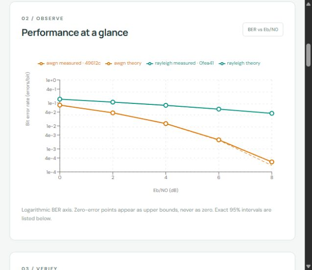

# Verification record

Recorded 2026-10-21. This distinguishes executed checks from supplied but unexecuted integrations.

| Check | Actual result |
|---|---|
| Backend pytest suite | **28 passed, 1 skipped**; final run 7.11 seconds |
| Skipped test | Real PostgreSQL/pgvector/Redis/Dramatiq smoke test: services not available |
| Frontend TypeScript + production build | Passed; generated API types refreshed |
| npm dependency audit | 0 known vulnerabilities reported |
| Python application/test lockfile audit | No known vulnerabilities reported by pip-audit |
| SQLite migrations | Upgrade, downgrade to base, upgrade passed on the separate migration-test database |
| Existing local run compatibility | Pre-plot-schema saved runs remained readable after adding nullable SVG artifact references |
| Compose configuration | docker compose config --quiet passed; containers were **not** run |
| PostgreSQL migration SQL | Both revisions compiled to SQL without connecting; this does not verify execution |
| Calibration evaluation | 4/4 deterministic cases passed |
| Held-out evaluation | 12/12 deterministic cases passed |
| Live model evaluation | Not run: no installed/configured model server |
| Browser walkthrough | Source upload, ingestion, evidence, review, execution, comparison and citation resolution verified |

Dependency audits are snapshots of published advisories, not proof of security. Container images and build-tool supply chains have not been comprehensively scanned. The pytest run emitted 350 dependency deprecation warnings, primarily from Matplotlib/pyparsing plus the Starlette/httpx test-client compatibility path; there were no test failures. The final command suppressed warning detail, not failures.

## What the tests exercise

- Known analytical BER values; actual Monte Carlo for both channels; repeatability within the recorded runtime.
- Parameter, resource, receiver and normalization validation.
- Result count/BER consistency and configured sweep completeness.
- Public verification-rule extension and zero-error confidence bounds.
- API submission/idempotency conflicts, progress completion, cancellation and artifact retrieval.
- Actual TXT/Markdown and generated synthetic PDF ingestion, page provenance and equation warnings.
- Reference/source-version filtering, embedding-index isolation, exact citation lookup.
- Workspace isolation for evidence, runs, artifacts and investigator tools.
- Duplicate concurrent workers, broker handoff rollback, bounded transient storage retries, expired leases, queued-delivery repair and cancellation fencing.
- Bounded investigator behavior, explicit review, delayed approval, resumption and actual completed simulations.
- Cross-module import restrictions.
- Provider contract tests use explicitly identified test doubles; these are not live-provider evaluations.

## Browser evidence

A real local API, SQLite database and local outbox worker were running behind the React UI. The walkthrough uploaded the synthetic handout, reviewed an AWGN/Rayleigh pair, submitted both jobs, observed succeeded states and a finished investigation, selected both curves, opened the comparison and resolved a citation to its stored version and SHA-256.

For the demonstrated seed-42, 100,000-bits-per-point runs, actual observed BER at 0 dB was 0.08058 (AWGN) and 0.14530 (Rayleigh). Their analytic references were approximately 0.0786496 and 0.146447. At 8 dB the AWGN run observed 27 errors, so the sample-adequacy rule warned about precision. These are particular Monte Carlo results, not universal benchmark values.

The browser exercise found a review-time deadline bug. Approval now renews the active-work deadline, and a regression test covers a review delayed by a day. The original failed investigation was retained as history rather than silently rewritten as successful.

## Evaluation interpretation

See the machine-readable reports in `eval/results-calibration.json` and `eval/results-heldout.json`.

The held-out reference hit@3 was 1.0 on **three** synthetic reference questions. Exact stored-text citation support passed. Two held-out scientific simulations reproduced exact counts and produced no theory warnings. The injected normalization fault was detected as inconsistent; the system does not claim a uniquely proven cause.

Median per-case elapsed time in the saved held-out report was approximately 0.00773 seconds; cases mix cheap retrieval/validation with simulation checks, so this is not an end-to-end model latency or a load-test result. The complete product walkthrough and test flow separately exercise queued simulation execution.

Model cost and diagnosis accuracy are null because they were not established. Basic-LLM, RAG-only LLM and live tool-agent comparisons remain pending. The raw-output evaluation script and human rubric are supplied; no scores were invented.

## Remaining gaps

1. Execute and harden the PostgreSQL/Redis path, including real process termination, queue outage and recovery tests. CI is configured but has not run remotely.
2. Run a pinned real chat/embedding provider, evaluate semantic retrieval and supported natural-language parameter extraction, and score the three modes with independent reviewers.
3. Expand beyond a tiny synthetic corpus; independently review scientific cases and add authentic handouts with appropriate permission.
4. Add team identities, membership roles, quotas and rate limiting before exposing the service beyond a trusted local setting.
5. Add safe artifact retention/cleanup, centralized worker metrics, backups/restore drills and stronger hostile-parser process supervision.
6. Improve conversation follow-ups, automated source-conflict handling and generic capability-driven UI rendering. Current offline rules intentionally use narrow patterns and reviewable defaults.

No arbitrary code execution, MATLAB interpretation, OCR, OFDM or hardware access is implemented.
